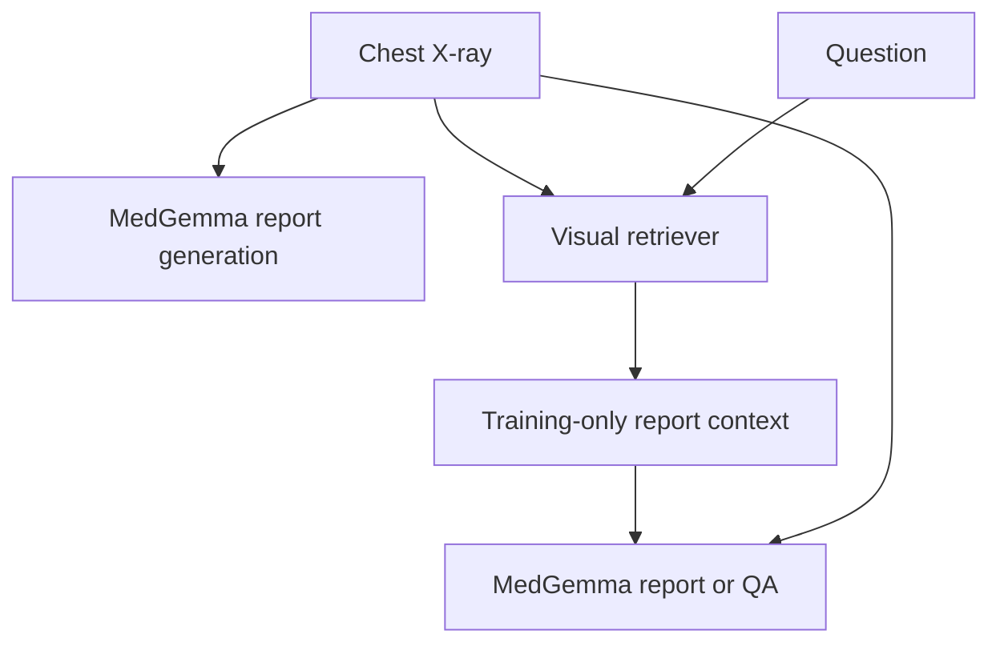

# CXR-Intelligence

Research prototype for chest X-ray report generation and retrieval-augmented QA.

## Research status - November 6, 2026

**Implemented:** MedGemma report-generation wrapper; BiomedCLIP and ColPali
retrieval components; report and QA pipelines; Gradio demo; evaluation tools.
Implementation is not evidence of accuracy or clinical validation.

**Verified in this audit:** automated software tests and a deterministic mock
smoke run. See the [research-credibility audit](docs/research_credibility_audit.md),
[case study](docs/research_case_study.md), and [PDF case study](docs/research_case_study.pdf).

**Not yet verified:** a controlled real-model comparison, retrieval accuracy,
fine-tuning improvements, hallucination reduction, or clinical safety. Historical
retrieval artifacts lack sufficient provenance to establish these findings.

| Evidence | Location | Interpretation |
|---|---|---|
| Audit mock run | [Results](results/audit_2026_11_06/mock/comparison_report.md) | Software execution only |
| Legacy aggregates | [Archive](results/legacy/README.md) | Historical, unverified; not performance evidence |
| Real-model evaluation | Pending | Requires permitted data, model access and compute |

This is not a clinically validated diagnostic system.

## Research questions

1. Does retrieval improve report grounding, or introduce unsupported findings?
2. How do BiomedCLIP and ColPali differ under the same evaluation protocol?
3. Which negation, laterality and unsupported-finding errors occur?

## Architecture



These are implemented pathways; no model ranking is implied. See
[architecture](docs/architecture.md) for constraints.

## Install and software checks

Python 3.10+; the audit used Python 3.12 on CPU. Full model inference needs
additional dependencies and separately authorized model weights.

```bash
git clone https://github.com/Roaa-838/cxr-intelligence2.git
cd cxr-intelligence2
python -m venv .venv
# Activate .venv using your shell's activation command.
python -m pip install -r requirements.txt
python -m pip install pytest
python -m pytest -q
python scripts/run_comparison.py --mock --n-samples 10
```

Mock outputs go to `results/mock/`. `--mock` deliberately uses synthetic fixtures
and skips learned BERTScore/RadGraph evaluators. Its lexical scores have no medical
interpretation. The smoke fixture is deterministic; it is not a radiograph dataset.

## Real evaluation inputs

Use only data you are authorized to process. The intended MIMIC-CXR source is the
[official PhysioNet dataset](https://physionet.org/content/mimic-cxr/2.1.0/), which
requires credentialed access. A third-party mirror is not proof of permission.
No restricted dataset was downloaded or uploaded during this audit.

`data/processed/metadata.csv` must have `study_id,text,split,image_path`;
`subject_id` is required for RAG indexing/evaluation. Paths may be absolute or
relative to the metadata CSV directory. Use actual official study/patient IDs
locally; do not invent IDs to bypass overlap checks. Keep patient data private.

QA JSON must be a nonempty list with `study_id,subject_id,question,answer,image_path`.
Image paths are resolved relative to that JSON file. Questions and reference
answers need manual verification. See [QA protocol](docs/qa_dataset_creation.md).

```bash
# Prepare authorized local data and verify official patient splits first.
# Clear MOCK_MODELS or set it to false before real evaluation.
python scripts/build_index.py --model both --data-dir data/processed --split train
python scripts/evaluate_report_gen.py --models medgemma --data-dir data/processed --split test --n-samples 10
python scripts/evaluate_qa.py --qa-dataset data/qa_dataset.json --retrievers clip colpali --n-samples 10
python scripts/run_comparison.py --data-dir data/processed --qa-dataset data/qa_dataset.json --n-samples 10
```

Real outputs go to `results/real/` (git-ignored because they may contain restricted
reports). Custom `--output-dir` locations need the same care. Publish only reviewed,
permitted aggregate results. Missing/corrupt images, labels, datasets, requested
splits and RAG indexes fail explicitly. Existing legacy indexes must be rebuilt
with split/patient provenance. Failed inference produces no aggregate score and a
nonzero exit status. Missing metric dependencies yield JSON `null` and an error/status,
not a zero score. No automatic positive conclusions are generated.

The **Clinical entity-overlap heuristic F1** is a separate keyword metric, not
RadGraph. It cannot establish clinical correctness or reliably score negation.
The token-F1 implementation uses unique-token sets, not SQuAD multiset scoring.

## Data, ownership and limitations

The repository alone cannot establish dataset authorization or each collaborator's
individual contribution. Confirm both before using first-person CV claims. The
case study describes the implemented project and this audit without inventing
ownership, clinical review, training runs or results.

The current cleanup removes patient-level excerpts and paths from published result
files. Original content remains in older Git commits; historical cleanup remains
outstanding. No claim of complete privacy compliance is made.
